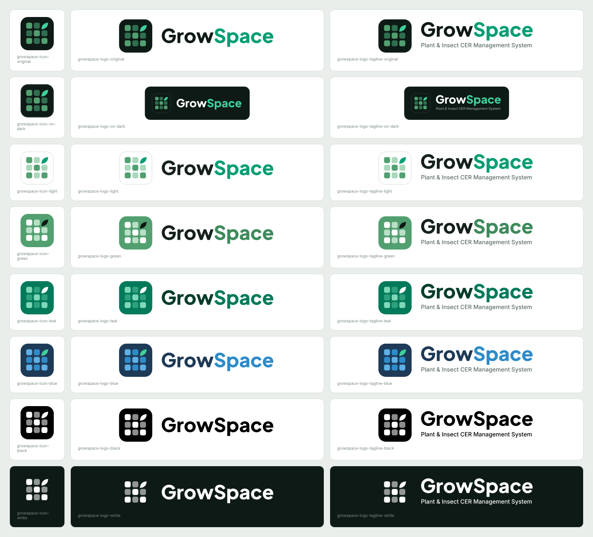

# GrowSpace icons and logos



```

svg/  Vector files - sharp at any size. Use these where you can (Word, PowerPoint, print, web).
png/  Images with transparent backgrounds. Icons at 1024 and 512 px; logos about 2000-2400 px wide.

Three shapes, each in every colour scheme:
  growspace-icon-*          the app icon on its own
  growspace-logo-*          icon + the GrowSpace name
  growspace-logo-tagline-*  icon + name + "Plant & Insect CER Management System"

Colour schemes:
  original  Original (dark tile)
  on-dark   Original, for dark backgrounds
  light     Light
  green     Green
  teal      Teal
  blue      Blue
  black     Black (one colour, for print)
  white     White (no tile, for dark backgrounds)

The "on-dark" logos carry their own dark background; the "white" set has none and is for
placing on dark photos or slides.
```

The app itself uses the original icon: `public/favicon.svg`, the PNG install icons and
`public/og-image.png` (link previews), and the `AppLogo` component in `src/App.jsx`.
